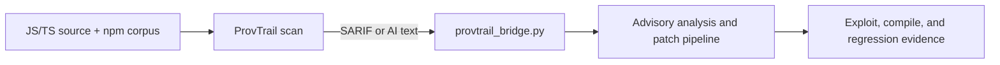

# ProvTrail integration record

This record documents the bounded integration with [ProvTrail](https://github.com/ElsonNg/sc4079-fyp).
ProvTrail is a complementary JavaScript/TypeScript provenance detector. It is
not the primary free5GC detector, and its static similarity result is not a
runtime exploit verdict.

## Data flow



| Stage | Input | Output | Evidence |
|---|---|---|---|
| ProvTrail | JS/TS source and corpus | advisory ID, package, file/line | SARIF/HTML |
| Bridge | ProvTrail export | pipeline advisory queue | combined JSON/Markdown |
| Existing pipeline | advisory and target | exploit, patch, regression verdict | raw pipeline report |

## Reproduction

The bridge accepts ProvTrail's stable SARIF or AI-text export:

```powershell
python provtrail_bridge.py `
  --scan tests/fixtures/provtrail/latest-scan.sarif `
  --source provtrail --no-probe --format json
```

The resulting combined evidence is preserved in:

- `reports/provtrail_link_20261011_170707.json`
- `reports/provtrail_link_20261011_170707.md`

The input fixture contains six unique advisories, with advisory IDs,
packages, priorities, confidence values, and source locations preserved in the
combined report. Because no package lab is mapped for these findings, the
pipeline records static/advisory/patch analysis only and makes no dynamic
confirmation claim.

The external ProvTrail checkout used for environment validation was pinned to
commit `e0c319cfd9ea196b3040e9d3dbaacb7a438761c6`. Its local embedding stack
installed successfully in a separate environment. A fresh corpus build was
attempted for `fastify`, but GitHub's unauthenticated API rate limit paused the
build; this is recorded as an environment limitation, not as a detector result.
To build a fresh corpus, provide a local `GITHUB_TOKEN`, then run
`provtrail corpus probe --limit 20`, select the required package scope, and
run `provtrail corpus build --package <package>` followed by
`provtrail corpus index --device cpu`.

The bounded dynamic demonstration remains:

```powershell
python provtrail_js_lab/run_demo.py
```

It confirms one hand-authored JavaScript prototype-pollution reproduction
through the existing pipeline execution path. It does not claim automatic
JavaScript classification or general coverage of all ProvTrail findings.

## Interpretation and limitations

- ProvTrail provenance is a detection/localization signal; dynamic confirmation
  and patch validation remain the responsibility of this pipeline.
- Free5GC remains the primary real-upstream research case and its headline
  metrics are unchanged by this supporting integration.
- Manual-review, failed, unmapped, and environment-limited results remain
  visible and are not counted as confirmed vulnerabilities.
- A clean ProvTrail scan is limited by the populated corpus and is not proof
  that the scanned project is vulnerability-free.
